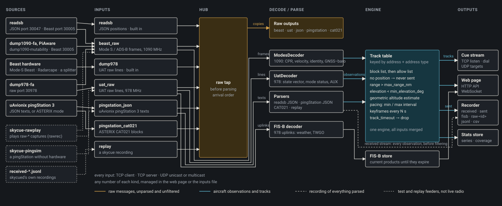

# Architecture

skycue is an operator console and cue forwarder for ADS-B and UAT receivers.
It reads what readsb, dump978-fa and similar programs already decode (and
decodes raw frames itself), shows a live map, and forwards chosen aircraft as
cues to your own programs.

## The data flow

Source programs (readsb, dump978-fa, a pingStation 3, a replay of a recording)
feed the **inputs**. An input is a TCP client, a TCP server or a UDP
listener, and speaks one format: readsb JSON, Beast frames, UAT lines,
pingStation JSON texts or ASTERIX CAT021, or a recording. Any number of
inputs run at once.

Inputs that carry raw bytes pass them to the **hub**. The hub copies the raw
bytes unchanged to the raw outputs (a consumer that stops reading is dropped
without delaying the others) and hands the frames to the decoders.

The **decoders** are the 1090 MHz Mode S decoder and the 978 MHz UAT decoder
in `skycued/src/decode/`. They are pure: no I/O and no clock of their own,
which is why they can be tested and fuzzed with plain byte strings. They turn
frames into **observations**. Inputs that already deliver decoded aircraft
(readsb JSON, pingStation JSON) produce observations directly.

Observations update the **track table**. The **engine** runs each track
through the filter chain (range, elevation angle, allow and block lists) and
makes a **decision**: forward it or not, and how often to send updates.

Forwarded tracks leave as **cues** on the cue stream (the wire protocol of
`libskycue`, `docs/protocol.md`), over the built-in outputs. The same track
table feeds the web server and the page, the recorder and the statistics
store.

FIS-B weather uplinks from the 978 MHz decoder go to the FIS-B decoder and
store in `skycued/src/fisb/`, which keeps the current picture for the map.

## Where things live

| path | holds |
|---|---|
| `libskycue/` | the cue-client library, the wire codec and the ECEF helpers |
| `skycued/` | the daemon |
| `net/` | `skycue::net`, the daemon's socket library (dialer, listener, framer, fan-out) |
| `www/` | the web page, plain JavaScript |
| `tools/` | the `skycue-*` command-line tools |
| `examples/` | client demos |
| `tests/` | unit, script, browser and fuzz tests, and fixtures |
| `scripts/` | development, fixture and map scripts |
| `packaging/`, `debian/`, `cmake/` | packages, the systemd unit, CMake modules |
| `docs/` | documentation |

Inside `skycued/src/`:

- `decode/`: the 1090 and 978 decoders and their key tables.
- `inputs/`: the input kinds, transports and the input manager.
- `outputs/`: output definitions.
- `hub/`: the raw-byte hub.
- `fisb/`: the FIS-B decoder, store and JSON writers.
- `asterix/`: CAT021 decoding, framing and encoding.
- `coding/`: bit reading and the Mode S CRC.

`libskycue` is standalone: it links only Boost.System and Threads and does
not use `net/`. See [docs/libskycue.md](docs/libskycue.md#getting-it-into-your-build).

## Threading and lifetime

The daemon runs its inputs, hub and outputs on one io thread, so they take no
locks. An input lives on the caller's `io_context`: register callbacks
before `start()`, call everything from that thread, and expect no callback
after `stop()` (which can be called twice and may be followed by `start()`).
`Hub::stop()` stops every output; `publish()` and `apply()` do nothing after it.
The details are in the comments of `skycued/src/inputs/input.hpp` and
`skycued/src/hub/hub.hpp`.

## Glossary

- **observation**: one decoded report about one aircraft.
- **track**: the state kept for one aircraft in the track table.
- **cue**: a TrackUpdate frame on the wire, sent to a client.
- **key**: the state key of a track: address, address type and rebroadcast
  class. Not the same as a config key.
- **decision**: whether to forward a track, from the filter chain.
- **baseline**: the saved overrides file.
- **overrides**: `skycue.overrides.toml`, layered over `skycue.toml`.
- **overlay**: unsaved live state, kept in `skycue.runtime.json`. The word
  also means a map overlay, which is unrelated.
- **feed**: the web page's word for an input. Code and config say input;
  ids say receiver.
- **hub**: the raw-byte fan-out from inputs to outputs.
