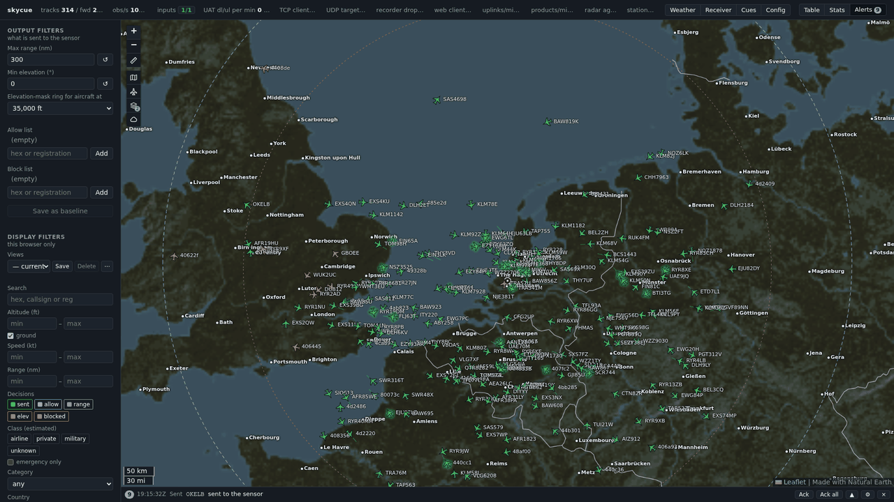

# skycue

skycue is an operator console and forwarding bridge for ADS-B and UAT
receivers. It is for people who already run readsb (and, in the USA,
dump978-fa) and want a live operator view of what their receiver sees, plus
a way to hand selected aircraft to their own programs and devices, without touching their
feeder. It reads what those decoders already decode, shows it on a live map
in the browser, and forwards chosen aircraft as cues to your own programs and devices. It
does not feed any network, replace your decoders or change their
configuration: your feeder keeps running exactly as it was.

Source: <https://github.com/zberry/skycue>. Packages and the source tarball:
[Releases](https://github.com/zberry/skycue/releases).



## Installing and building

All install and build instructions are in [docs/installing.md](docs/installing.md).
Download the `.deb`, the `.rpm` or the source tarball from the
[Releases page](https://github.com/zberry/skycue/releases). The routes, in short:

- **Debian and Raspberry Pi OS** (12 and 13; amd64, arm64): install the `.deb`, see [Debian and Raspberry Pi](docs/installing.md#debian-and-raspberry-pi).
- **RHEL 8 and 9** and their rebuilds (x86_64): install the `.rpm`, see [RHEL](docs/installing.md#rhel).
- **From source** with plain CMake: see [From source](docs/installing.md#from-source). Once it is built you can [run it straight from the build tree](docs/installing.md#run-it-from-the-build-tree) without installing anything.
- Whichever route you take, [turn on the one decoder output skycue reads](docs/installing.md#3-turn-on-the-decoder-output-skycue-reads) for readsb, ultrafeeder or PiAware.

## What it does

**Inputs.** skycued takes aircraft from:

- **readsb**, through its JSON position output (`--net-json-port 30047`, with
  aircraft that have no position included). This is the readsb you already
  run, as a service or inside ultrafeeder. UAT aircraft reach skycue through
  readsb too, once readsb has a `uat_in` connector to dump978-fa.
- **Any other 1090 MHz decoder that serves Beast output**, such as
  dump1090-fa under PiAware, dump1090-mutability, or a readsb on another
  machine: a small network-only readsb converts the Beast stream to the JSON
  output skycue reads. The installing guide has a ready unit file for it
  ([PiAware](docs/installing.md#piaware-dump1090-fa)).
- **readsb's Beast port, decoded by skycued itself** (`TRACK_DECODER=skycued`,
  optional): skycued decodes the Mode S frames, and estimates the geometric
  altitude that many aircraft never report. See
  [Decoding in skycued](docs/operating.md#decoding-in-skycued).
- **dump978-fa**, through its raw UAT port (30978): the 978 MHz frames and
  the FIS-B weather uplinks (USA).
- **pingStation 3** receivers (uAvionix's small networked ADS-B/UAT
  receiver), as JSON or ASTERIX CAT021 over UDP or TCP. Each one is a named
  input you add in the web page or in the inputs file; several can run at
  once.
- **Raw decoder output** as `beast_raw` (Beast frames) and `uat_raw`
  (dump978 lines) inputs, over TCP or UDP and multicast, for a decoder that
  skycue should only relay and record.
- **Recordings**, for running without hardware: a JSONL recording skycued
  made earlier (`--replay`), or the decoders' raw output captured with
  `skycue-rawrec`.

Everything merges into one track table, and the page's Receiver tab shows
the health of every input. Details:
[docs/operating.md](docs/operating.md#the-inputs-file).

**Outputs.** The same inputs can be served on again, as a hub: add outputs in
the web page, through the API or in the inputs file, and skycued serves the
raw Beast frames, the dump978 lines, readsb's JSON, the pingStation texts or
CAT021 blocks it receives to your own programs over a TCP listener, a TCP
target or UDP (multicast included), each output with its own consumers and
counters. A consumer that stops reading is dropped without delaying the
others. The cue streams are outputs too (`CUE_TCP_PORT`, `CUE_TCP_CONNECT`
and `CUE_UDP_TARGETS` define the built-in ones). Two new input types,
`beast_raw` and `uat_raw`, read a decoder's Beast port or raw UAT lines
directly over TCP or UDP (and `capture: true` records them for
`skycue-rawplay`). Details: [docs/operating.md](docs/operating.md#outputs).

**Decisions and cues.** For each aircraft skycued decides whether to
forward it, by range, elevation angle and allow and block lists that you can
change live, and how often to send updates. Forwarded aircraft go to your
own programs and devices as cues over TCP or UDP in a small, documented wire protocol
([docs/protocol.md](docs/protocol.md)). To receive them in your own program,
use the C++ client library ([docs/libskycue.md](docs/libskycue.md)).

**The web map.** skycued serves a map page that loads nothing from the
internet. It shows:

- aircraft coloured by the forwarding decision, with trails you can colour by decision, signal strength or altitude;
- a ruler for distances, and range and elevation rings around the receiver;
- one toolbar on the map whose buttons fold out the map style, the aircraft trails, the weather layers and the radar controls, so the map stays clear until you need them;
- saved views that bring back a set of filters and map settings with one key;
- a track table, and a side panel for the selected aircraft;
- alerts, a statistics view, and a Receiver tab with the health of every input;
- offline map tiles and overlays that you bake once.

There is no login, so open the page only to a network you trust. The page is
described in [docs/operating.md](docs/operating.md#the-web-ui); the HTTP and
WebSocket API behind it in [docs/web-api.md](docs/web-api.md).

**FIS-B weather.** From the 978 MHz uplinks skycued decodes NEXRAD radar,
METAR, TAF, PIREP, winds aloft and NOTAMs, keeps the current picture with its
expiry rules, and draws it on the map. It is for situational awareness only
and is not flight-critical ([docs/fisb.md](docs/fisb.md)).

**Recordings and statistics.** skycued can record what it received and what
it sent (JSONL and CSV), and keeps statistics across restarts, such as
coverage, range, signal and rates over time
([docs/recording-format.md](docs/recording-format.md)).

**Tools.** Installed beside the daemon:

- `skycue-dump` prints a cue stream one line per frame.
- `skycue-rawrec` and `skycue-rawplay` record and replay the decoders' raw output.
- `skycue-pingsim` plays a pingStation 3 towards a skycued input, without hardware.
- `skycue-stats` summarises recordings: coverage and the filter chain.
- `skycue-fisb` runs the FIS-B decoder offline on a capture or recording.
- `skycue-iqgen` makes IQ sample files so the whole chain can be tried without a dongle ([docs/iq-replay.md](docs/iq-replay.md)).

## How it fits beside your receiver

```
RTL-SDR 978 MHz -> dump978-fa --raw--> readsb <- RTL-SDR 1090 MHz
                       |                 |
                       | raw UAT         | JSON
                       v                 v
                       +---------> skycued ---> cue clients (TCP / UDP)
                                         \---> recordings
```

skycue is a client of readsb (also inside ultrafeeder, or behind PiAware's
dump1090-fa through a second, network-only readsb) and of dump978-fa. It
connects to the JSON port and the raw UAT port they can serve, and never
feeds a network, restarts or reconfigures them. The one option you turn on
per setup is in [docs/installing.md](docs/installing.md#3-turn-on-the-decoder-output-skycue-reads),
and `skycued --check-inputs` tells you whether skycue can reach the decoders.
A pingStation 3 is another input, added in the web page or the inputs file.

## Requirements

- Linux: Debian 12 or 13 or Raspberry Pi OS (amd64, arm64), RHEL 8 or 9 and rebuilds (x86_64).
- To build: CMake 3.25 or newer, a C++17 compiler, Boost and zlib. The release tarball carries the web libraries, so nothing is downloaded; a git clone fetches them once with `scripts/dev/fetch-web-libs.sh`.
- To bake the offline map: network access once (about 310 MB of Natural Earth data) and GDAL, or podman or docker (see [docs/installing.md](docs/installing.md#5-bake-the-map)).
- A web browser. No internet access is needed at runtime.
- readsb (and dump978-fa for UAT), or a pingStation 3, as the source of aircraft.

## Documentation

| file | read it when |
|---|---|
| [installing.md](docs/installing.md) | you install or build skycue and connect it to your decoders |
| [operating.md](docs/operating.md) | you run it: config keys, the web page, recordings, replay, the tools |
| [web-api.md](docs/web-api.md) | you script against the HTTP and WebSocket API |
| [protocol.md](docs/protocol.md) | you write a client for the cue wire protocol |
| [libskycue.md](docs/libskycue.md) | you use the C++ client library |
| [fisb.md](docs/fisb.md) | you want to know which FIS-B products are decoded, skipped and shown |
| [recording-format.md](docs/recording-format.md) | you read or write skycued's recordings |
| [iq-replay.md](docs/iq-replay.md) | you make IQ files to try the chain without a dongle |
| [make-tiles.md](docs/make-tiles.md) | you bake map tiles by hand or re-cut a region |
| [make-locations.md](docs/make-locations.md) | you add report locations (airports) for weather on the map |

For contributors:

| file | read it when |
|---|---|
| [fisb-reference.md](docs/fisb-reference.md) | you need the UAT uplink bit layouts and their sources |
| [fisb-golden.md](docs/fisb-golden.md) | you change the FIS-B decoder and check its golden output |
| [asterix-cat021-reference.md](docs/asterix-cat021-reference.md) | you work on the pingStation ASTERIX CAT021 decoding |
| [hardening.md](docs/hardening.md) | you run the sanitizer, fuzz, static-analysis and soak checks |
| [releasing.md](docs/releasing.md) | you cut a release and build the packages |

## Repository layout

| path | holds |
|---|---|
| `libskycue/` | the cue-client library (`skycue::skycue`) |
| `skycued/` | the daemon: decoders, track table, web server |
| `tools/` | the command-line tools (`skycue-dump`, `-rawrec`, `-rawplay`, `-pingsim`, `-stats`, `-fisb`; `iqgen/` for `skycue-iqgen`) |
| `www/` | the web page (Leaflet and ECharts are added from `sources/` at build time) |
| `cmake/` | CMake modules |
| `examples/` | a client demo and a parent-project example |
| `docs/` | the documentation |
| `packaging/` | the config example, systemd unit, RPM spec, container build and verify scripts, source tarball script |
| `debian/` | Debian packaging |
| `scripts/` | `maps/` (map tiles and overlays), `dev/` (sanitizers, fuzzing, static analysis), `fixtures/` (test captures and generated tables), `lib/` |
| `tests/` | unit and script tests; `tests/fuzz/` holds the libFuzzer harnesses, seeds and findings |

## Status

Version 0.1.0, the first public release. The configuration file and the
cue protocol may still change between minor versions; each release says
what changed.

## Contributing

Issues and pull requests are welcome on GitHub. A git clone has no `sources/`:
run [`scripts/dev/fetch-web-libs.sh`](scripts/dev/fetch-web-libs.sh) once (it
fetches the two web libraries, see
[Building from a git clone](docs/installing.md#building-from-a-git-clone)),
then build as described in [docs/installing.md](docs/installing.md#build) with
`cmake -S . -B build`, and run `ctest --test-dir build` before sending a change; some tests skip themselves when an optional tool or
capture is missing. The sanitizer, fuzzing and static-analysis runs are in
[docs/hardening.md](docs/hardening.md).

## Licence

Apache-2.0: see [LICENSE](LICENSE) and [NOTICE](NOTICE). The web page
includes Leaflet (BSD-2-Clause) and Apache ECharts (Apache-2.0, with parts
derived from D3 under BSD-3-Clause); the maps are baked from Natural Earth
(public domain).
